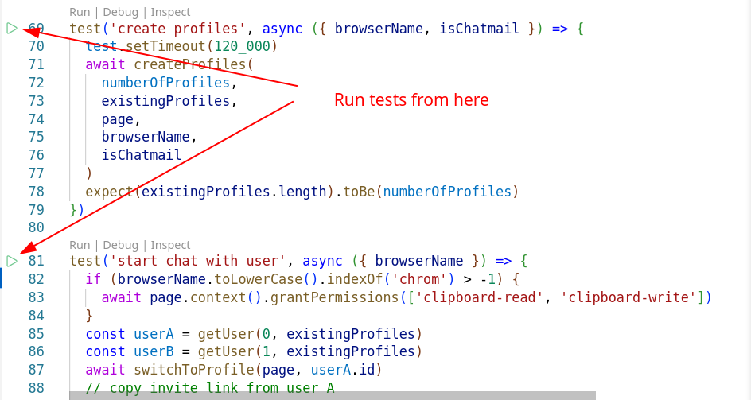

# End to end tests

## Install playwright

after running `pnpm install`

cd into packages/e2e-tests and run `pnpm exec playwright install --with-deps`

Copy packages/e2e-tests/\_env to packages/e2e-tests/.env

A convenient alternative to install and use playwright is the VSCode [plugin](https://playwright.dev/docs/getting-started-vscode). It also provides some functionality for running or recording tests.



Be aware that the tests in each spec file are NOT isolated, so the order they are executed matters. Otherwise we would have to create and delete all profiles and preparations for each test which would slow down all tests dramatically.

## Usage

This package depends on the target-browser so consider taking a look at its [README](../packages/target-browser/Readme.md),
e.g. if you want to enable TLS.

```sh
pnpm -w e2e
```

for headless usage

or

```sh
pnpm -w e2e --ui
```

for [UI mode](https://playwright.dev/docs/test-ui-mode)

```sh
pnpm -w e2e basic
```

to run only tests in file basic-tests.spec.ts (all tests that match by second parameter)

or

```sh
pnpm -w e2e --project=non-chatmail
```

to run all tests with option chatmail = false (to use non chatmail server)

```sh
pnpm -w --filter e2e-tests e2e:report
```

to show the last report

`pnpm -w e2e` also builds the browser target before running the tests.
When you run Playwright directly there is a stale-build-guard to avoid
running the tests against an outdated build
(see _packages/e2e-tests/stale-build-guard.ts_).

The account dirs for tests are _packages/e2e-tests/data/app-instance-\*/accounts_

The whole _data/_ dir can be deleted after running tests
and will be recreated in the next run.

## Writing multi-app-instance tests

Utilize `openInstancePage()`. Use the "add a second device" test as an example.

## Electron tests

Tests in _packages/e2e-tests/electron-tests_ drive the real Electron app
instead of the browser target. Use them only for what the browser target
can't do: webxdc apps, calls, other additional windows, native dialogs,
IPC/security boundaries. Everything else belongs in _tests/_,
which is faster and easier to debug.

```sh
pnpm -w e2e:electron                 # build electron target + run all
pnpm --filter=e2e-tests e2e:electron webxdc  # without rebuilding, filtered
```

Like the browser tests, they refuse to run against a stale build.
On Linux without a display, wrap the command in `xvfb-run`.

In CI (_.github/workflows/e2e-electron.yml_) tests run on Linux, macOS and
Windows, except tests tagged `@network` (e.g. calls, which need a relay):
those only run on Linux. Tag tests that need a relay with
`{ tag: '@network' }`.

`DeltaChatElectron.launch()` from _electron-helper.ts_ starts an app instance
with an isolated, temporary profile dir (via `DC_TEST_DIR`),
so it never touches your real profile and can run next to an installed
Delta Chat. Several instances can run at the same time
(e.g. caller and callee, see _calls.spec.ts_).

- Every window of the app is a Playwright `Page`: use
  `dc.callWindow()` or `dc.waitForWindow(urlRegex)`, which fail if more than
  one window matches. For webxdc apps prefer `dc.openWebxdc(messageListItem)`:
  it clicks "Start" and returns the window of exactly that message,
  also when several apps are open.
- `page.evaluate()` does not work in the main window (the app blocks `eval`),
  use `dc.evalInMainWorld()` if you need it. Clipboard access goes through
  `dc.setClipboard()` / `dc.readClipboard()`.
  Webxdc and call windows support `page.evaluate()`.
- Native file dialogs are replaced with `dc.mockOpenDialog([path])`.
  Use `dc.app.evaluate()` to patch other main-process APIs the same way.
- Camera and microphone are faked by Chromium.
- `buildXdc(dir)` packs a directory into a .xdc file,
  see _fixtures/webxdc-test-app_.
- Call `dc.attachLogs(testInfo)` on failure to add the app/core log
  to the report.

## Troubleshooting

Make sure that there are no accounts left after fail.
`rm -r packages/e2e-tests/data/app-instance-*/accounts`

After failing tests or stopping tests with Ctrl + C sometimes either the rpc-server process is still running or the used port is still blocked by a process
To find the related process pid (on Linux) run:

`ps -aef | grep rpc-server` or for the process blocking the port:

`lsof -i:3000`
